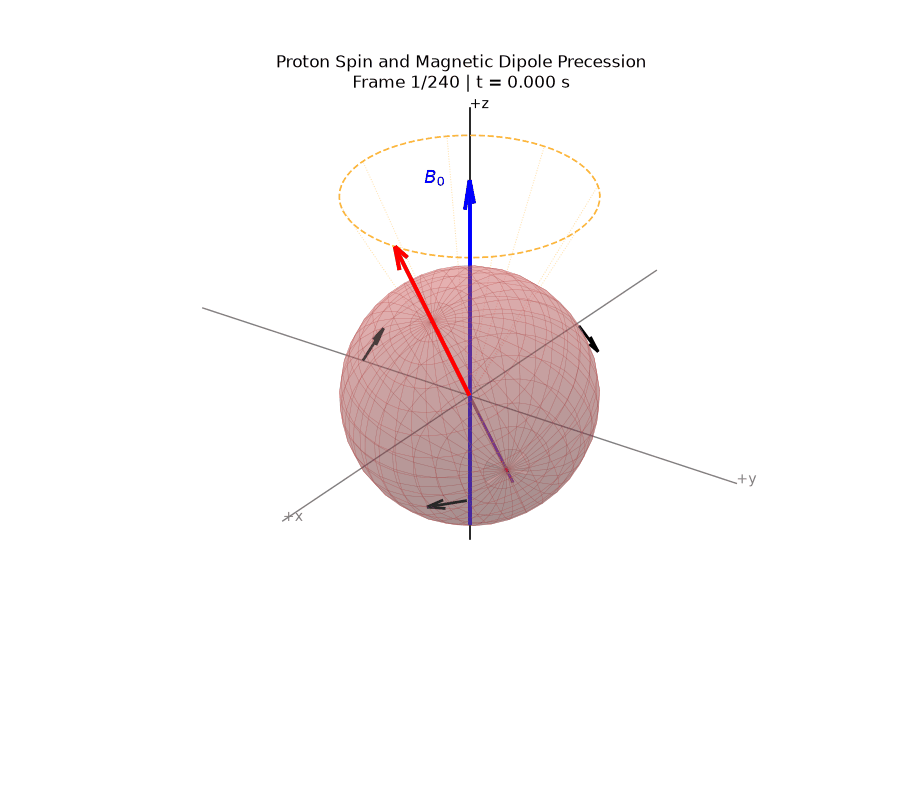
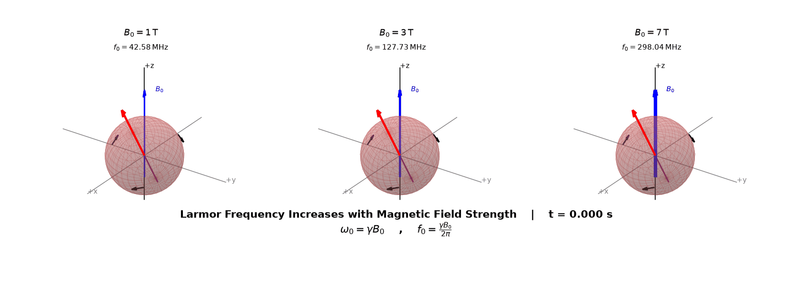
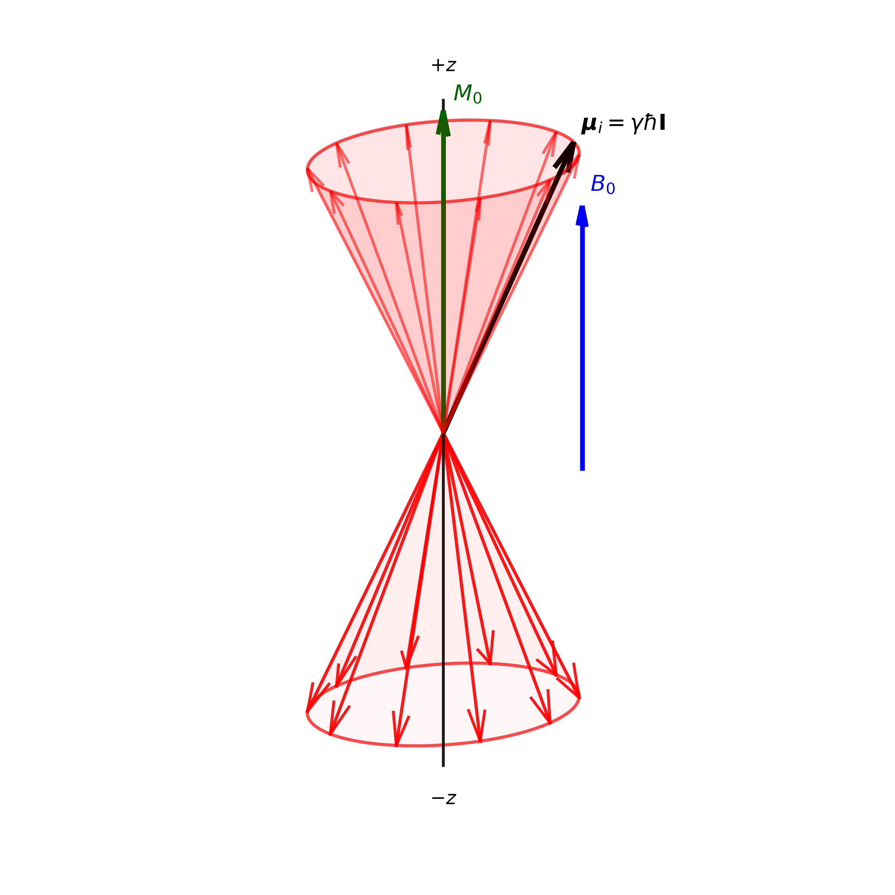
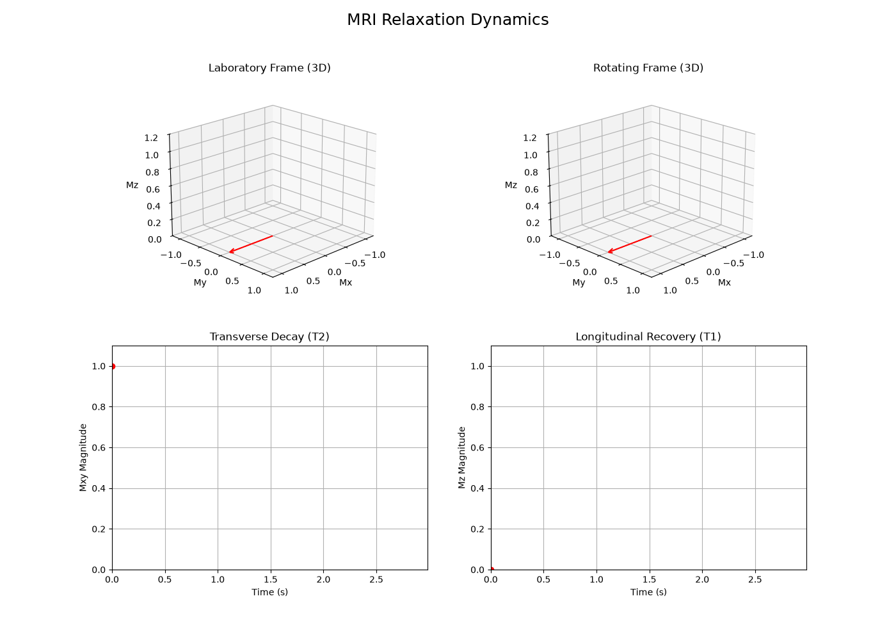
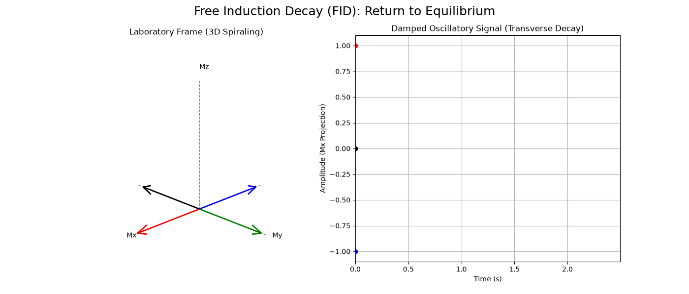
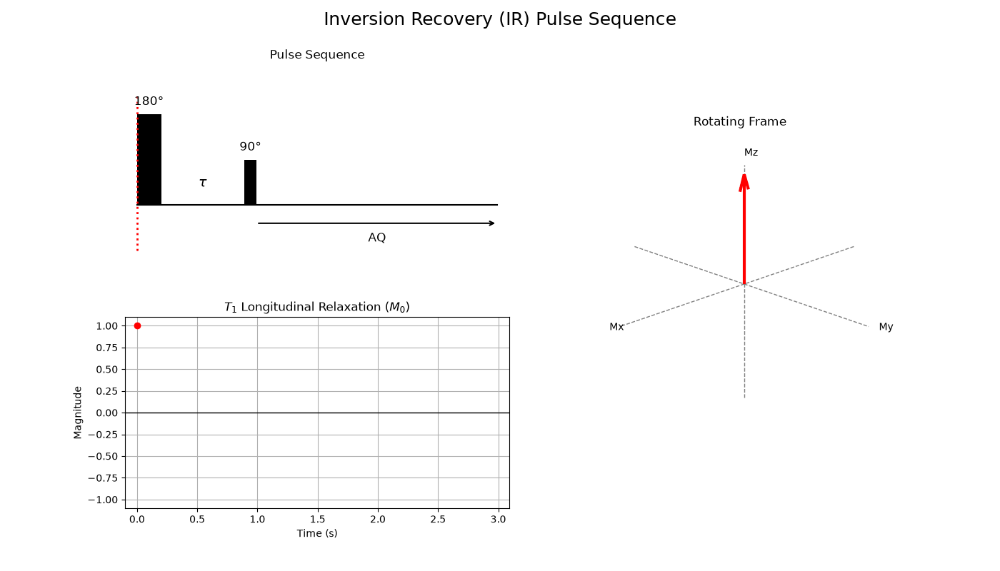

# MRI Physics Modeling

A Python-based educational simulation and visualization tool designed to bridge abstract MRI physics math with 3D reality. 

This project uses a dependency-light stack built entirely on pure NumPy for the mathematical Bloch equations engine and Matplotlib for the 3D rendering.

## Precession Visualization

**Proton Precession**  
Visualizes the fundamental behavior of a net magnetization vector precessing around the main magnetic field ($B_0$) at the Larmor frequency.

  

**Larmor $B_0$ Comparison**  
Demonstrates the effect of varying magnetic field strengths on the rate of precession.

## Macroscopic Magnetization

**Net Magnetization Vector ($M_0$)**  
Illustrates how individual precessing proton spins align parallel and anti-parallel to the main magnetic field to produce a net macroscopic magnetization vector.

  

## $2 \times 2$ Excitation & Relaxation Dashboard

This simulation creates a synchronized, four-panel dashboard displaying a 90° RF excitation pulse followed by free relaxation:
1. **3D Laboratory Frame:** Shows full Larmor precession during the RF tip-down and subsequent T1/T2 relaxation.
2. **3D Rotating Frame:** Isolates the right-hand rule torque of the $B_1$ field and pure relaxation by observing from a frame spinning at the Larmor frequency.
3. **2D Transverse Plane (Mxy):** Tracks the real-time Free Induction Decay (FID) signal generation and T2 decay.
4. **2D Longitudinal Axis (Mz):** Tracks real-time T1 recovery.

## Free Induction Decay (FID) & Phase Shifts

This module visualizes the Free Induction Decay (FID) signal generation as the macroscopic magnetization vector loses transverse coherence and spirals back to equilibrium along the Z-axis.

Depending on the axis of the applied RF pulse ($90^{\circ}|x'$, $90^{\circ}|y'$, $90^{\circ}|-x'$, or $90^{\circ}|-y'$), the resulting magnetization vector will have four different possible on-axis initial phases. The simulation below models these four distinct initial orientations simultaneously. While each vector traces a unique phase-shifted damped oscillatory signal, they are all constrained by the exact same exponential decay envelope.

## Inversion Recovery (IR) Pulse Sequence

This module simulates a 180° - $\tau$ - 90° Inversion Recovery sequence, demonstrating the precise timing required to visually null specific tissues based on their $T_1$ recovery times. The synchronized three-panel dashboard visualizes:

* **Pulse Sequence Diagram:** Tracks the chronological application of the 180° inversion pulse, the Inversion Time (TI or $\tau$) relaxation period, and the 90° readout pulse.
* **Longitudinal Relaxation ($M_z$):** Traces the exact inversion recovery curve mathematically, highlighting the theoretical null point ($TI = T_1 \ln 2$) where the macroscopic signal crosses zero.
* **3D Rotating Frame:** Isolates the right-hand rule torque of the active RF pulses and the pure longitudinal recovery of the magnetization vector.

## References

The mathematical models and physics principles visualized in this repository are based on the following foundational texts:

* Xia, Y. (2022). *Essential Concepts in MRI: Physics, Instrumentation, Spectroscopy, and Imaging* (1st ed.). Wiley.
* Bushberg, J. T., et al. (2002). *The Essential Physics of Medical Imaging* (2nd ed.). Lippincott Williams and Wilkins.
* Hobbie, R. K., & Roth, B. J. (2007). *Intermediate Physics for Medicine and Biology* (4th ed.). Springer.
* Rougier, N. P. (2021). *Scientific Visualization: Python + Matplotlib*. Open-access.
